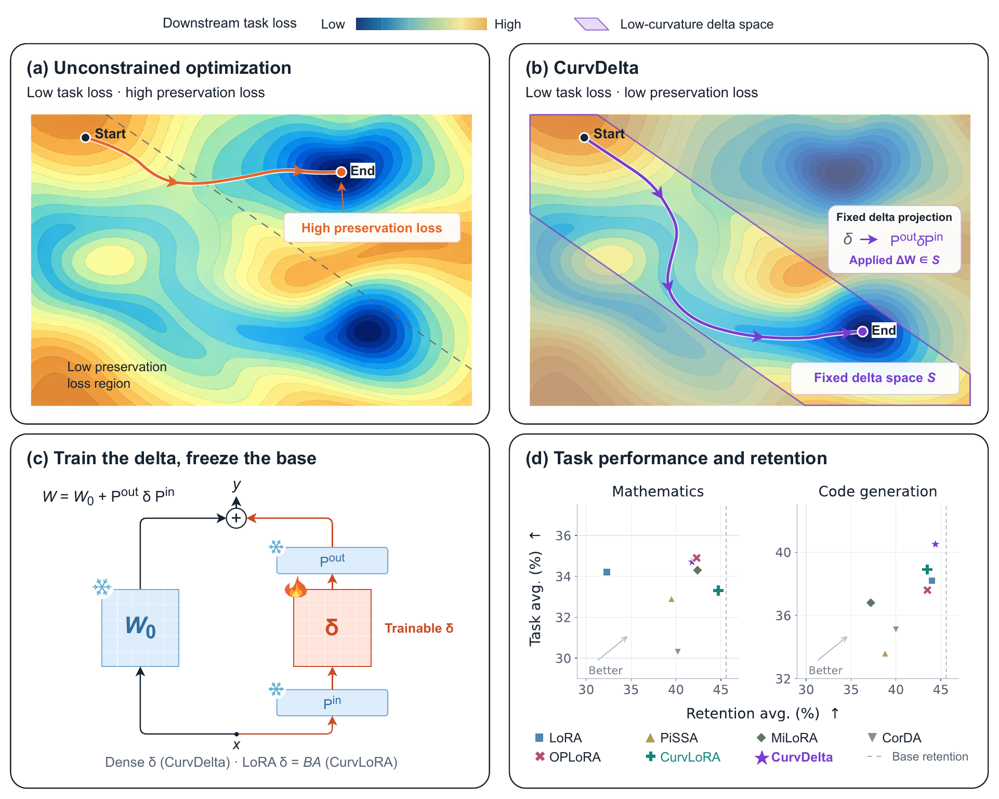

# CurvDelta: Low-Curvature Delta Modeling For Surgical Learning and Unlearning

This repository contains the unlearning implementation of CurvDelta and CurvLoRA, based on OpenUnlearning ([project](https://github.com/locuslab/open-unlearning)).



**Overview.** (a) Unconstrained optimization reaches low task loss but high preservation loss. (b) CurvDelta constructs a low-curvature delta space. The applied delta remains in this space throughout optimization, reaching a different solution with comparable task loss. (c) The base weights and projections remain frozen. The trainable delta is a dense matrix in CurvDelta or LoRA in CurvLoRA. (d) Performance comparison. The dashed line marks the base model's retention average. Our methods achieve the best trade-off between task performance and capability retention. [PDF](overview.pdf)

## Abstract

A central challenge in adapting large language models (LLMs) is capability preservation: an adaptation can achieve its target while degrading general capabilities. We introduce CurvDelta, a scalable framework that incorporates the preservation constraint into the parameterization of the model update. By analyzing the local geometry of the preservation constraint around the pre-adaptation model, CurvDelta constructs a low-curvature space in which parameter updates leave the preservation loss nearly invariant. We make its construction practical for LLMs through Kronecker-factored approximate curvature (K-FAC) and a factorized projection. We also introduce CurvLoRA, a low-rank variant within the same preservation geometry, designed for more efficient adaptation. Both methods apply to preservation-constrained adaptation tasks such as capability learning and selective unlearning. We evaluate our methods on mathematical reasoning, code generation, and knowledge unlearning. For mathematical reasoning and code generation, our approaches achieve competitive downstream performance while better preserving general capabilities, offering a favorable acquisition--retention trade-off relative to the baselines. For knowledge unlearning, our main results on TOFU and MUSE show a better balance between targeted forgetting and knowledge retention than the baselines, with retention performance close to the from-scratch retraining reference.

## Quick Start

```bash
pip install -r requirements.txt
pip install -e .
pip install -U huggingface_hub
```

Set the data root and available GPUs before running an experiment. `HF_TOKEN` and `WANDB_API_KEY` are optional and must be supplied through the environment when needed.

```bash
export PROJECT_DATA_ROOT=/path/to/project-data
export GPU_IDS=0,1
export HF_TOKEN=your_huggingface_token
export WANDB_API_KEY=your_wandb_api_key
bash common_utils/download_cli.sh all
bash scripts/curvLoRA/01-tofu-3b-f10-simnpo-er-sweep.sh
```

## Data and Checkpoints

The experiment configurations read TOFU and MUSE Books from Hugging Face. Authenticate once with `hf auth login`, or export your own `HF_TOKEN`; never store a token in this repository. The download helper places all required data and checkpoints under `PROJECT_DATA_ROOT`:

```bash
export PROJECT_DATA_ROOT=/path/to/project-data
bash common_utils/download_cli.sh tofu  # TOFU data, full models, and retain90/retain95 references
bash common_utils/download_cli.sh muse  # MUSE Books data, target model, and retrain reference
```

TOFU Forget Quality (FQ) compares the unlearned model with the appropriate retain-only reference. Before running an unlearning script, evaluate that reference and keep its log at the path expected by the launchers. For Llama-3.1-8B-Instruct and Forget 10%, run:

```bash
python src/eval.py --config-name=eval.yaml \
  experiment=eval/tofu/default.yaml \
  model=Llama-3.1-8B-Instruct \
  model.model_args.pretrained_model_name_or_path=${PROJECT_DATA_ROOT}/models/open-unlearning/tofu_Llama-3.1-8B-Instruct_retain90 \
  forget_split=forget10 holdout_split=holdout10 \
  task_name=tofu_Llama-3.1-8B-Instruct_retain90 \
  paths.output_dir=saves/eval/tofu_Llama-3.1-8B-Instruct_retain90
```

This must produce `saves/eval/tofu_Llama-3.1-8B-Instruct_retain90/TOFU_EVAL.json`. Use `retain95`, `forget05`, and `holdout05` for Forget 5%; use the matching 3B checkpoint and model name for 3B experiments.

For MUSE Books, the recommended path is to download `muse-bench/MUSE-books_target` and `muse-bench/MUSE-books_retrain`. Generate the retrain reference log once:

```bash
python src/eval.py --config-name=eval.yaml \
  experiment=eval/muse/default.yaml data_split=Books \
  model=Llama-2-7b-hf \
  model.model_args.pretrained_model_name_or_path=${PROJECT_DATA_ROOT}/models/muse-bench/MUSE-Books_retrain \
  task_name=muse_Llama-2-7b-hf_Books_retrain \
  paths.output_dir=saves/eval/muse_Llama-2-7b-hf_Books_retrain
```

This produces `saves/eval/muse_Llama-2-7b-hf_Books_retrain/MUSE_EVAL.json`. Readers who want to generate their own unlearned MUSE Books baselines can run `bash scripts/muse_unlearn.sh`; downloading the official target checkpoint is sufficient for the representative CurvDelta and CurvLoRA scripts. This repository does not include MUSE News experiments.

## Main Unlearning Results

Unlearning under SimNPO. CurvLoRA is the low-rank variant of CurvDelta. TOFU uses Llama-3.1-8B-Instruct; MUSE Books uses Llama-2-7B. FQ and MU are higher-is-better, while FP and forget-set memorization are lower-is-better.

| Method | TOFU F5 FQ ↑ | TOFU F5 FP ↓ | TOFU F5 MU ↑ | TOFU F10 FQ ↑ | TOFU F10 FP ↓ | TOFU F10 MU ↑ | MUSE VerbMem ↓ | MUSE KnowMem ↓ | MUSE Retain KnowMem ↑ |
|---|---:|---:|---:|---:|---:|---:|---:|---:|---:|
| Retrain | -- | 10.8 | 63.2 | -- | 10.6 | 64.6 | 14.2 | 29.5 | 68.6 |
| Original | -11.8 | 99.0 | 62.7 | -26.8 | 99.2 | 62.7 | 99.7 | 46.6 | 69.1 |
| FT | -0.5 | 13.0 | 54.6 | -1.4 | 14.4 | 38.9 | 23.3 | 27.6 | 46.8 |
| [CrispEdit](https://icml.cc/virtual/2026/poster/62453) | -0.2 | 12.7 | 59.3 | -1.9 | 16.9 | 42.0 | 14.3 | 29.2 | 53.8 |
| LoRA | -7.4 | 22.6 | 63.1 | -13.5 | 18.2 | 64.6 | 31.6 | 31.1 | 53.4 |
| [VILA](https://arxiv.org/abs/2508.21300) | -2.2 | 19.8 | 62.9 | -8.4 | 17.7 | 66.8 | 29.8 | 34.8 | 59.0 |
| [OPLoRA](https://ojs.aaai.org/index.php/AAAI/article/view/40703) | -4.5 | 21.6 | 64.5 | -15.5 | 27.4 | 62.9 | 18.5 | 29.3 | 58.2 |
| **CurvLoRA** | **-1.3** | **7.6** | **62.6** | **-3.7** | **3.4** | **62.5** | **20.0** | **31.2** | **57.6** |
| **CurvDelta** | **-0.1** | **6.3** | **63.3** | **-1.1** | **6.5** | **63.2** | **11.6** | **32.1** | **55.8** |

The portable environment and download helpers are under `common_utils/`. Representative CurvLoRA, CurvDelta, OPLoRA, CrispEdit, FFT, LoRA, VILA, and Qwen3-4B fine-tuning scripts are under `scripts/`.

For simplicity, only representative scripts are shown in this repository. Readers can customize their script by modifying relevant variables in corresponding files, including LLM backbone, hyperparameter, fine-tuning method, and unlearning trainer.

## License

This project retains the OpenUnlearning MIT license. See [LICENSE](LICENSE).
